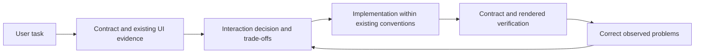

# Architecture and decision method

## Runtime package

The installable directory is `skills/ux-engineering`. Discovery exposes its name and description. Loading `SKILL.md` selects design or audit mode and gives the core evidence-to-decision workflow. The agent loads only references needed for its current task: backend interpretation, interaction decisions, workflow/feedback, layout/consistency, accessibility, audit, stack integration or cases.

Conditional resilience guidance routes supplied-composition tasks to `reference-fidelity.md`. That reference preserves the brief, assets and responsive relationships without making portfolio styling or animation a default for operational screens. Secondary history summaries are documented separately from directly retrieved cases.

No parser, model endpoint, MCP server, external skill or hardcoded component library is required. Research and evaluation files remain outside the installed skill so normal usage does not load transcripts, expected answers or benchmark tooling.

## Decision record

Each significant decision connects user task, evidence, interaction, invariant and uncertainty. Factors include closed/open values, number of selections, search/disambiguation, effect timing, risk, frequency, viewport and established design system. No universal enum-to-select or mobile-to-drawer rule is imposed.

Example: owner lookup is paginated and permission-scoped → search eligible names on the server → display distinguishing desk context → submit the opaque ID → retain the current selected label independently → test selected owner absent from page one. Missing lookup or edit contracts remain unknown rather than being filled with invented endpoints.

Layout decisions follow the same method. Inspect the shell and working inner page, then fix the shared control/layout cause. Consolidate equivalent headers/actions and horizontal toolbar groups while keeping responsive wrapping and accessible target sizes. The goal is useful density, not maximum compression.

## Design and audit outputs

Design produces a task flow and justified decisions before code. Audit produces findings with trigger, location, consequence, evidence type, severity, correction, invariant and verification. Report-only requests do not authorize application changes. Severity measures task impact, not personal taste.

## Development and validation boundary

`scripts/validate.py` checks package portability and fixture integrity. `scripts/score.py` validates explicit grading records and aggregates completed runs; it never guesses usability from words in an output. Tests cover the aggregation's rejection paths and the adapter's permission/data boundaries. Agent outputs require semantic judging; browser rendering and assistive-technology behavior require separate checks.

This architecture deliberately avoids a schema parser and a model-specific benchmark API. The skill's useful unit is the agent's reasoning workflow; a parser would not resolve unknown domain meaning. Evaluation prompts and saved outputs can be used with different agent hosts under controlled conditions.
