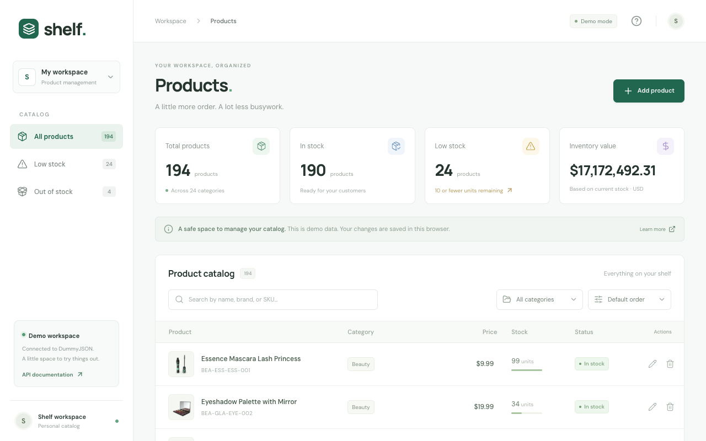
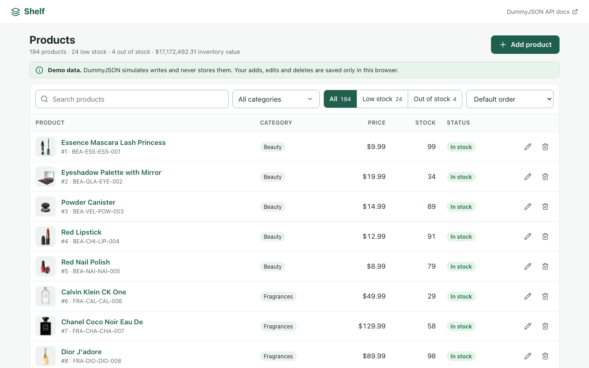
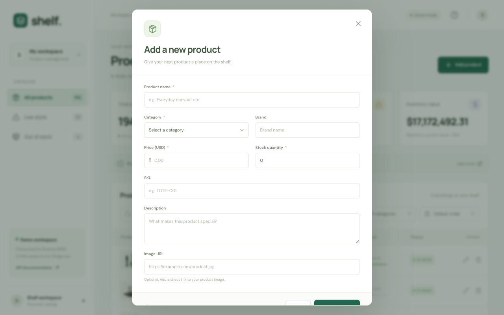
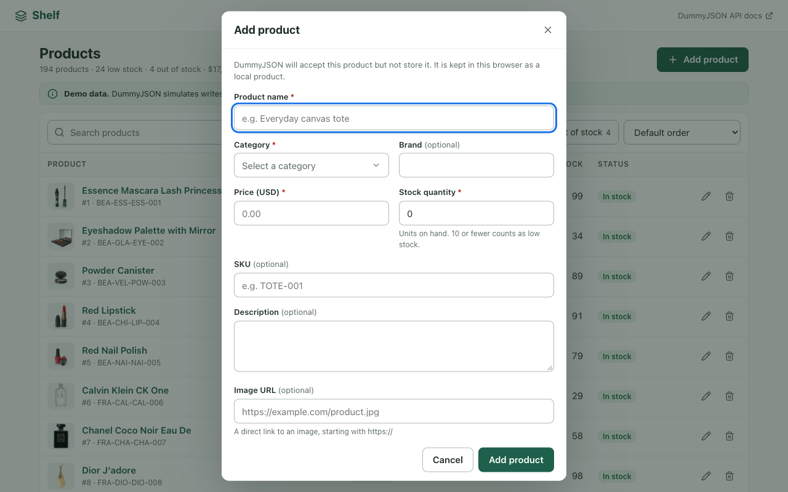
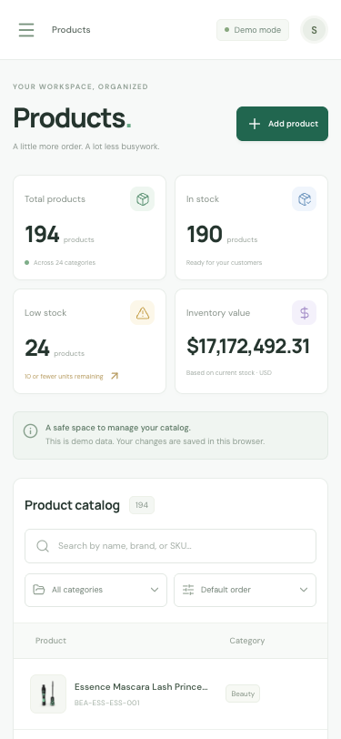
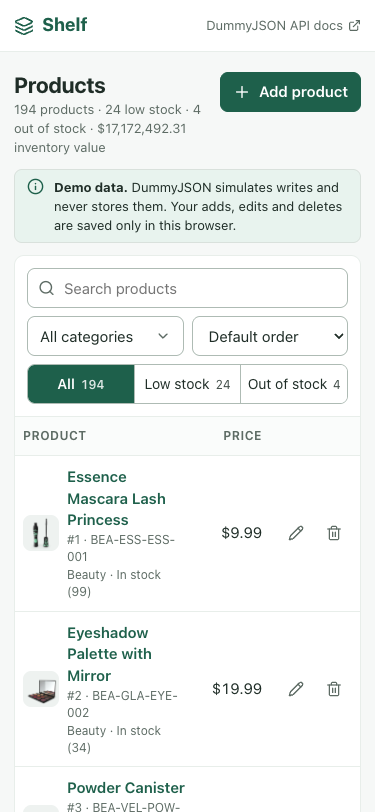
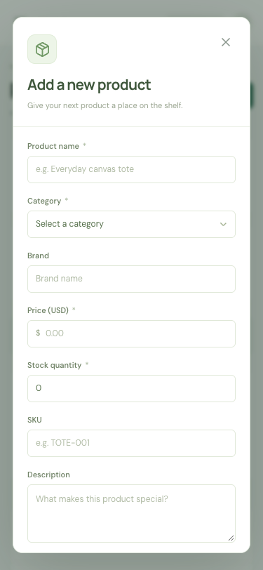
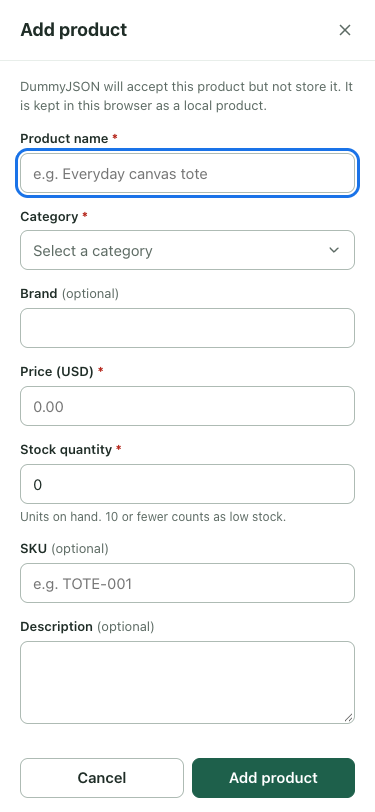

# Public API React case study: results

Date: 26 October 2026. API: [DummyJSON products](https://dummyjson.com/docs/products) (synthetic data; writes are simulated and never stored). Method and caveats: [PROTOCOL.md](PROTOCOL.md).

## What was compared

| | Baseline | Skill-assisted |
|---|---|---|
| Prompt | "Build me a React frontend to manage products. Integrate https://dummyjson.com/docs/products for CRUD." | Same task, starting from a copy of the baseline, with the installed `ux-engineering` skill plus the instruction to follow frontend best practices and use established libraries |
| Source | [apps/baseline](apps/baseline) | [apps/with-skill](apps/with-skill) ([notes](apps/with-skill/NOTES.md)) |

**This is a demonstration, not a controlled experiment.** The skill-assisted pass was a second pass over an existing app, with an extra best-practice instruction. Those are confounders, and it ran once. It cannot show how much of the difference comes from the skill.

## Screenshots (same 1280×800 and 375×812 viewports, same API data)

| | Baseline | Skill-assisted |
|---|---|---|
| Desktop list |  |  |
| Desktop add form |  |  |
| Mobile list |  |  |
| Mobile add form |  |  |

## Observed differences

Observed in the screenshots and source, not scored by a rubric:

- **First screen:** the baseline spends the top of the page on a sidebar, a topbar, a heading block, four stat cards and a banner, so the table starts about 460px down and two rows are visible at 1280×800. The revision shows one header, one `h1`, a one-line summary and one notice, with about eight rows visible. On mobile the baseline shows one partly visible row and the revision about two and a half.
- **Repeated or non-functional chrome:** the baseline has a workspace switcher, a user avatar and a help icon that do nothing, and states "demo data" in several places. The revision removed these and keeps one notice.
- **Add form at 800px height:** in the baseline the dialog footer (Cancel / Save) is clipped below the viewport; in the revision the footer stays visible.
- **Category:** both versions use a dropdown-style control. The baseline uses a native `<select>` over categories derived from loaded products; the revision uses a searchable combobox over `/products/category-list`. The baseline's choice was already reasonable, so this is a refinement.
- **Behaviour in the source:** the revision adds per-field validation, draft preservation after a failed save, a double-submit guard, a discard prompt, local-only handling for created products, and Undo on delete. The full table is in the [notes](apps/with-skill/NOTES.md).
- **Remaining inconsistency:** the sort control is still a native `<select>` next to the combobox, and the two look different. That is a small consistency flaw left in the revision.

## Checks that were run

| Check | Baseline | Skill-assisted |
|---|---|---|
| TypeScript | passes (per its notes) | passes (re-run, 0 errors) |
| Unit and component tests | 3 tests (per its notes) | 22 tests pass (re-run) |
| Production build | passes (per its notes) | passes (re-run); one JS chunk of about 524 kB, with Vite's 500 kB warning |
| Page-level horizontal overflow at 1280 and 375px | none | none |
| Manual flows in a browser | not run | run by the build agent: add, validation, failed save then retry, delete with Undo, 375px layout |

## Not measured

- No automated accessibility scan (axe or Lighthouse), no screen reader, no WCAG conformance claim.
- Screenshots come from one browser (Chromium); no real touch device, 320px or zoom, or dark theme.
- No repeated runs, no blinded human rating, no scoring rubric applied. Nothing here is a benchmark.
- The live API catalogue can change; counts such as 194 products reflect the date above.
